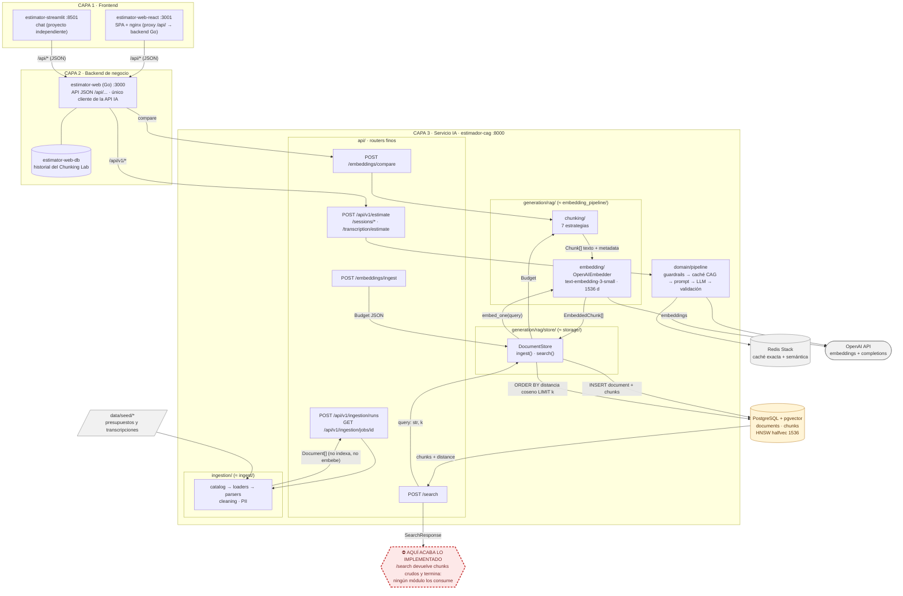
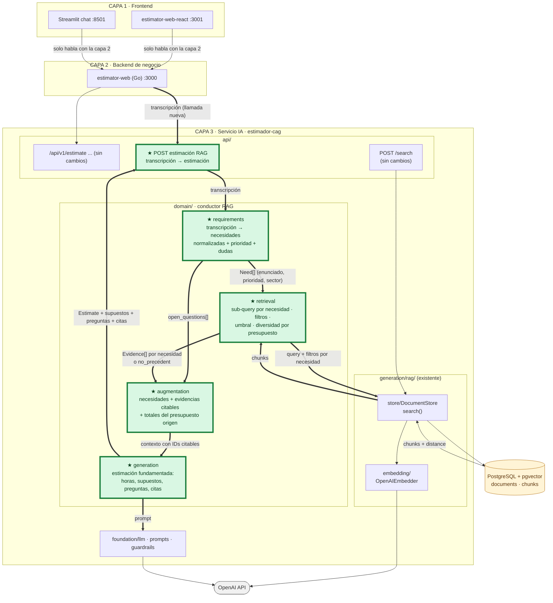

# Diagnóstico arquitectónico — Sesión 09 (pre-work)

> **Estado de las capas (cambio `refactor-clientes-tres-capas`).** Este documento refleja la arquitectura *actual*:
> **frontends → backend de negocio → servicio IA**, y **solo `estimator-web-go` (API JSON bajo `/api/`) llama a
> `estimador-cag`**. React (`estimator-web-react`) y Streamlit (`estimator-streamlit/`, proyecto independiente) hablan
> únicamente con el backend. El trace de la sección 2 y los fallos 1-5 de la sección 3 son del servicio IA (capa 3) y no
> cambian con el refactor.

> Estado analizado en el trace: cierre de la Sesión 08 (`master`, commit `4138d3c`), contra el stack
> Docker (`docker compose up -d`). Observaciones en español; comandos, payloads y nombres de campo en inglés.
>
> **Equivalencia de nombres.** El enunciado habla de `ingest/`, `embedding_pipeline/` y `storage/`. En este repo
> son, respectivamente: `estimador-cag/app/ingestion/`, `app/generation/rag/{chunking,embedding}/` y
> `app/generation/rag/store/` (+ `app/foundation/persistence/`).
>
> **Dos matices sobre el enunciado**, comprobados en el código (`GET /openapi.json`):
> 1. No existe un endpoint que devuelva el embedding de un texto: la vectorización ocurre *dentro* de
>    `POST /embeddings/ingest` y `POST /search`. El paso 1 del trace la reproduce con el mismo modelo
>    (`text-embedding-3-small`) mediante `examples/trace_s09.py`, que llama a OpenAI como cliente.
> 2. La rama base del repo es `master` (no hay `main`); el PR va contra `master`.

---

## 1. Diagrama de la arquitectura actual



**Lectura del diagrama**

- Hay tres líneas de datos que **no se tocan**: (a) estimación con LLM (`CAG`, Redis + OpenAI); (b) ingestión batch de
  ficheros (`ingestion/`, produce `Document[]` y se queda ahí: no embebe ni indexa); (c) RAG de presupuestos
  (`chunking → embedding → DocumentStore → pgvector`).
- `DocumentStore` solo es alcanzable desde `POST /embeddings/ingest` y `POST /search` (`grep` de
  `get_document_store`): **el flujo que estima (a) nunca consulta pgvector**.
- **Las capas se respetan.** `estimator-web-react` (nginx `proxy_pass` de `/api/` a `API_UPSTREAM=http://estimator-web:3000`)
  y Streamlit (`httpx` a `ESTIMATOR_WEB_URL`) solo llaman al backend `estimator-web` (Go), que es el único cliente de la
  API IA; ni React ni Streamlit tienen referencias de red a `estimador-cag`.
- Si llega una transcripción, lo único que el sistema puede hacer con ella en el lado RAG es tratarla como un
  `query: str` y devolver los `k` chunks más cercanos. Ahí termina.

---

## 2. Trace anotado de `02_ambiguous.txt`

**Entorno.** Stack levantado y sano; la base ya contenía el corpus de ejemplo (`data/budgets_sample.json`).

```sh
docker compose up -d --build
docker compose ps --format 'table {{.Name}}\t{{.Status}}'
```
```text
estimator-estimador-cag-1         Up 33 seconds (healthy)
estimator-postgres-1              Up About a minute (healthy)
estimator-redis-1                 Up About a minute (healthy)
estimator-estimator-web-1 / -web-react-1 / -estimador-cag-chat-1 / -estimator-web-db-1   Up (healthy)
```
```sh
curl -s localhost:8000/health
# {"status":"healthy","environment":"development","provider":"openai","model":"gpt-4o-mini"}

docker compose exec -T postgres psql -U estimator -d estimator \
  -c "select count(*) as docs from documents" -c "select count(*) chunks, count(embedding) embedded from chunks"
# docs = 15 · chunks = 52 · embedded = 52     (sectores: finance, ecommerce, healthcare, industrial)
```

**Comando del trace** (cliente efímero en un contenedor de la propia imagen; el script solo hace las dos llamadas y
las imprime, sin lógica de servicio):

```sh
docker compose run --rm --no-deps -v "$PWD/examples:/examples:ro" \
  -e ESTIMATOR_BASE_URL=http://estimador-cag:8000 \
  --entrypoint python estimador-cag /examples/trace_s09.py /examples/transcripts/02_ambiguous.txt
```

### Paso 1 — Embeber la transcripción completa

Salida cruda (bloque `STEP 1` del script, que llama a OpenAI con el mismo modelo que usa el servicio):

```text
model           : text-embedding-3-small
dimensionality  : 1536
L2 norm         : 0.999812
first component : 0.006241
last component  : 0.018997
```

**Comentario.** El vector es *un único punto* de 1536 dimensiones que resume toda la reunión: mezcla en una sola
dirección «tienda gourmet online + club de puntos + panel de ventas + pago con tarjeta + email de pedido» con el ruido
conversacional (anécdotas familiares, saludos). La norma ≈ 1 indica que viene normalizado (coseno ≈ producto escalar);
la primera y la última componente no significan nada por sí solas: las dimensiones no son interpretables.

### Paso 2 — Búsqueda semántica (top-5)

Misma ejecución, bloque `STEP 2`: el script hace `POST http://estimador-cag:8000/search` con
`{"query": "<transcripción completa>", "k": 5}`. Tabla del script:

```text
search_time_ms  : 2363
  rank  chunk_id  distance  sector     budget_id     content
     1        16    0.6082  ecommerce  BUD-2024-005  [Project: Headless e-commerce storefront ...] Component: Product catalog API
     2        17    0.6137  ecommerce  BUD-2024-005  ...                                           Component: Cart and checkout service
     3        18    0.6372  ecommerce  BUD-2024-005  ...                                           Component: Personalized recommendations
     4        19    0.6386  ecommerce  BUD-2024-005  ...                                           Component: Storefront PWA
     5        27    0.6443  ecommerce  BUD-2024-008  [Project: Fashion returns ...]                Component: Returns portal
```

Respuesta cruda (JSON de `/search`; el único recorte es el campo `query`, que repite la transcripción entera):

```json
{
  "query": "<eco de la transcripción completa de 02_ambiguous.txt, omitido aquí por longitud>",
  "k": 5,
  "search_time_ms": 2363,
  "results": [
    {
      "chunk_id": 16,
      "document_id": 5,
      "chunk_type": "budget_component",
      "content": "[Project: Headless e-commerce storefront with personalized recommendations]\n[Client sector: ecommerce | Year: 2024 | Main tech: node]\n\nComponent: Product catalog API\nDescription: GraphQL catalog API with faceted search, inventory availability and multi-currency pricing backed by Elasticsearch.\nTech stack: node, graphql, elasticsearch\nComplexity: medium\nEstimated hours: 150",
      "distance": 0.6082057243748971,
      "metadata": {
        "year": 2024,
        "chunk_id": "BUD-2024-005::CATALOG-001",
        "budget_id": "BUD-2024-005",
        "complexity": "medium",
        "token_count": 76,
        "component_id": "CATALOG-001",
        "client_sector": "ecommerce",
        "estimated_hours": 150.0,
        "main_technology": "node"
      }
    },
    {
      "chunk_id": 17,
      "document_id": 5,
      "chunk_type": "budget_component",
      "content": "[Project: Headless e-commerce storefront with personalized recommendations]\n[Client sector: ecommerce | Year: 2024 | Main tech: node]\n\nComponent: Cart and checkout service\nDescription: Stateless cart service with promotion engine, tax calculation and a checkout orchestration that integrates the payment provider.\nTech stack: node, redis, postgresql\nComplexity: high\nEstimated hours: 140",
      "distance": 0.6137200654833178,
      "metadata": {
        "year": 2024,
        "chunk_id": "BUD-2024-005::CART-002",
        "budget_id": "BUD-2024-005",
        "complexity": "high",
        "token_count": 78,
        "component_id": "CART-002",
        "client_sector": "ecommerce",
        "estimated_hours": 140.0,
        "main_technology": "node"
      }
    },
    {
      "chunk_id": 18,
      "document_id": 5,
      "chunk_type": "budget_component",
      "content": "[Project: Headless e-commerce storefront with personalized recommendations]\n[Client sector: ecommerce | Year: 2024 | Main tech: node]\n\nComponent: Personalized recommendations\nDescription: Collaborative-filtering recommendations served from a feature store and exposed as a low-latency API for product and cart pages.\nTech stack: node, redis\nComplexity: medium\nEstimated hours: 110",
      "distance": 0.6371832455323361,
      "metadata": {
        "year": 2024,
        "chunk_id": "BUD-2024-005::RECO-003",
        "budget_id": "BUD-2024-005",
        "complexity": "medium",
        "token_count": 78,
        "component_id": "RECO-003",
        "client_sector": "ecommerce",
        "estimated_hours": 110.0,
        "main_technology": "node"
      }
    },
    {
      "chunk_id": 19,
      "document_id": 5,
      "chunk_type": "budget_component",
      "content": "[Project: Headless e-commerce storefront with personalized recommendations]\n[Client sector: ecommerce | Year: 2024 | Main tech: node]\n\nComponent: Storefront PWA\nDescription: Progressive web app storefront consuming the headless APIs with server-side rendering for SEO.\nTech stack: next_js, react\nComplexity: low\nEstimated hours: 60",
      "distance": 0.6386345981180004,
      "metadata": {
        "year": 2024,
        "chunk_id": "BUD-2024-005::STORE-004",
        "budget_id": "BUD-2024-005",
        "complexity": "low",
        "token_count": 72,
        "component_id": "STORE-004",
        "client_sector": "ecommerce",
        "estimated_hours": 60.0,
        "main_technology": "node"
      }
    },
    {
      "chunk_id": 27,
      "document_id": 8,
      "chunk_type": "budget_component",
      "content": "[Project: Fashion returns management and resale portal]\n[Client sector: ecommerce | Year: 2023 | Main tech: dotnet]\n\nComponent: Returns portal\nDescription: Self-service returns portal with label generation, reason capture and automatic restock or resale routing.\nTech stack: dotnet, sqlserver\nComplexity: medium\nEstimated hours: 140",
      "distance": 0.6443199029634796,
      "metadata": {
        "year": 2023,
        "chunk_id": "BUD-2024-008::RET-001",
        "budget_id": "BUD-2024-008",
        "complexity": "medium",
        "token_count": 72,
        "component_id": "RET-001",
        "client_sector": "ecommerce",
        "estimated_hours": 140.0,
        "main_technology": "dotnet"
      }
    }
  ]
}
```

**Comentario.** `distance` es distancia coseno (menor = más parecido): 0,61–0,64 equivale a una similitud de ~0,36–0,39,
es decir, **parecidos flojos y casi idénticos entre sí**, sin ningún corte que diga «esto no es un buen precedente».
Cuatro de los cinco chunks salen del mismo presupuesto.

### Paso 3 — Lectura de los chunks devueltos

Lo que pide el cliente (de la transcripción): tienda online (catálogo, carrito) · **pago con tarjeta, «fundamental»** ·
club de puntos / fidelización · **panel de control** con pedidos, más vendidos y stock · email de confirmación de pedido.

| # | Chunk | Presupuesto (año, tech) | Sector | Dist. | ¿Relevante? |
|---|---|---|---|---|---|
| 1 | `16` Product catalog API (150 h) | BUD-2024-005 · Headless e-commerce storefront (2024, node) | ecommerce | 0,6082 | **Sí** — «que vea los productos»; algo sobredimensionado (GraphQL + Elasticsearch multi-divisa) para una tienda de barrio. |
| 2 | `17` Cart and checkout service (140 h) | BUD-2024-005 (2024, node) | ecommerce | 0,6137 | **Sí** — carrito y checkout con proveedor de pago; cubre parcialmente el «pago fácil». |
| 3 | `18` Personalized recommendations (110 h) | BUD-2024-005 (2024, node) | ecommerce | 0,6372 | **No** — el cliente no pidió recomendaciones; es proximidad temática («e-commerce»), no de requisito. |
| 4 | `19` Storefront PWA (60 h) | BUD-2024-005 (2024, node) | ecommerce | 0,6386 | **Sí** — front de la tienda. |
| 5 | `27` Returns portal (140 h) | BUD-2024-008 · Fashion returns & resale portal (2023, dotnet) | ecommerce | 0,6443 | **No** — devoluciones de moda; nada que ver con un gourmet que aún no tiene tienda online. |

**Veredicto honesto.** El *sector* es correcto, pero el resultado es **malo para estimar**: 3/5 son relevantes y los tres
sirven a **una sola de las cinco necesidades** («vender online»). No aparece nada de pago con tarjeta propiamente
dicho, ni panel de ventas, ni fidelización, ni emails; y dos de los cinco son ruido plausible.

### Consultas de contraste (evidencia para la sección 3)

Mismo endpoint `/search`, `k=5`, con una necesidad por consulta. Comando tipo (se repite cambiando `query`):

```sh
curl -s localhost:8000/search -H 'Content-Type: application/json' \
  -d '{"query":"Secure card payment gateway integration","k":5}'
```

Resumen (distancia · presupuesto · sector · componente) de las 5 consultas y de una variante en español:

| Consulta (`query`) | Mejor resultado | Resto del top-5 |
|---|---|---|
| `Online store for gourmet food products: catalog, cart and checkout` | 0,4918 · BUD-005 · ecommerce · Cart and checkout | 0,52–0,59: catálogo, inventario, PWA, recomendaciones |
| `Tienda online de productos gourmet con carrito y pago con tarjeta` (mismo contenido, en español) | 0,6087 · BUD-005 · Cart and checkout | 0,66–0,68: catálogo, reserva de franjas de entrega, inventario, **optimización de rutas** |
| `Secure card payment gateway integration` | 0,4457 · **BUD-003 · finance** · Payment gateway core | 0,50–0,58: merchant dashboard, conciliación, antifraude, KYC (BUD-006) |
| `Sales dashboard with orders, best sellers and stock charts` | 0,6028 · BUD-003 · **finance** · Merchant dashboard | 0,61–0,63: checkout, catálogo, PWA, Care team dashboard (**healthcare**) |
| `Order confirmation email notifications to customers` | 0,6283 · BUD-001 · **finance** · Push and email notifications | 0,70–0,74: checkout, pedidos divididos, disputas, reventa |
| `Customer loyalty program with points accumulation and redemption` | 0,6390 · BUD-005 · Cart and checkout | 0,67–0,71: recomendaciones, devoluciones, entrega, pagos a vendedores — **ninguno es fidelización** |

---

## 3. Diagnóstico: cinco fallos identificados

### Fallo 1 — La transcripción entera se usa como una sola consulta (dilución multi-necesidad)
- **Problema observado:** Con la transcripción completa, el top-5 cubre una sola necesidad («vender online») y ninguna de
  las otras cuatro (Paso 2/3). Una consulta por necesidad sí encuentra lo que la completa nunca mostró: la
  pasarela de pagos de BUD-003 a 0,4457 (la mejor distancia de todo el trace), además de candidatos de panel y email.
- **Causa probable:** No hay etapa de *Query*: `POST /search` recibe `query: str` y lo embebe tal cual; un único vector
  promedia temas distintos y el ruido de la charla (Paso 1).
- **Propuesta de solución:** Etapa de **comprensión de la transcripción** que la descomponga en necesidades discretas y
  genere una sub-consulta por necesidad.

### Fallo 2 — Brecha de idioma y registro entre la consulta y el corpus
- **Problema observado:** La misma petición en español coloquial da 0,6087 de mejor distancia frente a 0,4918 en inglés
  técnico, y la cola degenera (optimización de rutas, franjas de entrega). Transcripción en español, corpus en inglés.
- **Causa probable:** Se compara lenguaje hablado, indirecto y en otro idioma («un panel, algo visual…») contra
  descripciones técnicas en inglés («Merchant dashboard», «Payment gateway core»); nada normaliza el texto de entrada.
- **Propuesta de solución:** En la misma etapa de comprensión, **normalizar cada necesidad a enunciado técnico
  canónico** en el idioma/vocabulario del corpus antes de buscar.

### Fallo 3 — Sin filtros por metadatos ni umbral de relevancia: siempre devuelve «algo»
- **Problema observado:** Se devuelven `k` chunks con similitud ~0,36–0,39 como si fueran buenos precedentes, incluidos dos
  falsos positivos (recomendaciones, portal de devoluciones de moda). Para fidelización no hay precedente en el corpus
  y aun así el sistema devuelve «Cart and checkout» a 0,6390; para el panel y el email, los mejores aciertos son de
  *finance*/*healthcare*, sin forma de saber si eso es aceptable.
- **Causa probable:** `DocumentStore.search` solo ordena por distancia y corta por `k`: no usa `client_sector`,
  `year` ni `main_technology` (el `metadata` jsonb tiene índice GIN, sin usar) y no existe umbral ni señal de «sin
  precedente».
- **Propuesta de solución:** Etapa de **política de recuperación**: filtros por metadatos derivados de la transcripción,
  umbral de relevancia y resultado explícito `no_precedent` por necesidad.

### Fallo 4 — Recuperación a nivel de chunk, sin cobertura ni diversidad
- **Problema observado:** 4 de 5 resultados son del mismo presupuesto (BUD-2024-005) y el quinto es de otro proyecto
  sin relación (BUD-2024-008); cada chunk trae las horas de *un componente*, pero no el total del proyecto, y nada
  indica qué parte de la petición queda sin cubrir.
- **Causa probable:** Un único ranking plano por chunk (`ORDER BY distance LIMIT k`): los chunks de un mismo presupuesto
  se parecen entre sí y se llevan todo el top-k; `/search` no devuelve nada a nivel de presupuesto.
- **Propuesta de solución:** Etapa de **orquestación de recuperación** por necesidad que fusione resultados, diversifique
  por presupuesto y enriquezca cada evidencia con los datos de su presupuesto de origen.

### Fallo 5 — El flujo no se cierra: nadie convierte la evidencia en una estimación
- **Problema observado:** `/search` termina en una lista de chunks (Sección 1); el endpoint que sí estima
  (`/api/v1/transcription/estimate`) nunca consulta pgvector — `DocumentStore` solo se importa desde
  `api/embeddings.py` y `api/search.py` —. Una transcripción ambigua («decidme un número y vemos») no produce estimación,
  ni supuestos, ni preguntas abiertas.
- **Causa probable:** Faltan las etapas de *Augmentation* y *Generation* sobre lo recuperado; la estimación existente es
  CAG con ejemplos fijos en `foundation/prompts/examples.py`, no con presupuestos recuperados. El hueco
  `generation/rag/retriever.py` está reservado pero vacío.
- **Propuesta de solución:** **Ensamblado de contexto** (necesidades + evidencias citables) y **generación fundamentada**
  que devuelva estimación con supuestos, preguntas abiertas y citas de los presupuestos usados, orquestada por el
  conductor de `domain/`.

### Otros
- **No hay endpoint de embedding.** El Paso 1 tuvo que llamar a OpenAI directamente; si el modelo del servicio
  (`EMBEDDING_MODEL`) cambia, el trace y el servicio divergen sin aviso.
- **Dos rutas de ingesta desconectadas.** `POST /api/v1/ingestion/runs` (limpieza + PII) «no indexa ni embebe»
  (docstring del orquestador), y la base está sembrada con `data/budgets_sample.json` (`BUD-2024-0xx`), no con los
  presupuestos limpios de `data/seed/budgets/` (`BUDGET-2024-000x`).
- **Corpus pequeño y sesgado:** 15 presupuestos / 52 chunks en 4 sectores, sin precedentes de fidelización ni de
  analítica de ventas para retail; parte de los «malos resultados» son cobertura de datos, no de arquitectura.
- **Capas (resuelto).** Antes React y Streamlit hablaban directo con la capa 3; el cambio `refactor-clientes-tres-capas`
  los reencaminó por `estimator-web`, de modo que solo el backend de negocio conoce el servicio IA (ver Sección 1).
- **Latencia del primer `/search`:** 2363 ms con la transcripción completa (incluye embeber ~2 kB de texto con una
  llamada externa); no es el cuello de botella hoy, pero se multiplicará con una sub-consulta por necesidad.

---

## 4. Propuesta de evolución arquitectónica

Leyenda: **verde con borde grueso y ★ = nuevo** (propuesto, aún no implementado); azul/gris = ya existe en la Sección 1;
flechas gruesas = flujo nuevo.

**Regla de capas (ya vigente):** la capa 1 solo habla con la capa 2, y **solo el backend de negocio (`estimator-web`)
llama a la capa 3** (servicio IA). Esta regla ya se cumple en la Sección 1; el diagrama de abajo solo añade el flujo RAG
propuesto detrás del mismo backend.



Cuatro módulos nuevos, orquestados por un conductor RAG en `domain/` (los hermanos de `generation/` solo se encuentran
ahí). **requirements** convierte la transcripción en necesidades estructuradas (enunciado técnico normalizado,
prioridad, sector) y en preguntas abiertas (fallos 1 y 2). **retrieval** lanza una sub-consulta por necesidad al
`DocumentStore` existente, con filtros, umbral y diversidad por presupuesto, y devuelve evidencias o `no_precedent`
(fallos 3 y 4). **augmentation** une necesidades, evidencias y totales del presupuesto de origen en un contexto con IDs
citables; **generation** emite la estimación con supuestos, dudas y citas sobre `foundation/llm` (fallo 5). Flujo:
transcripción → `Need[]` → `Evidence[]` por necesidad → contexto → estimación. La pieza crítica, y la primera que
construiría, es **requirements**: lo posterior solo es tan bueno como las preguntas que se hagan (el trace: una
consulta por necesidad halló la pasarela de pagos que la transcripción entera no vio).
